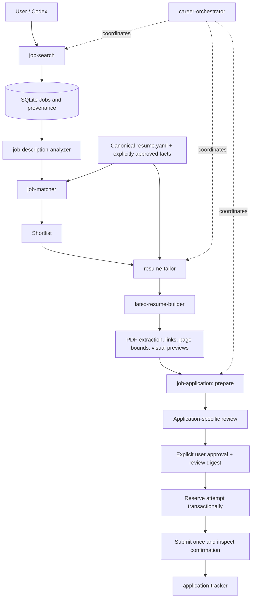
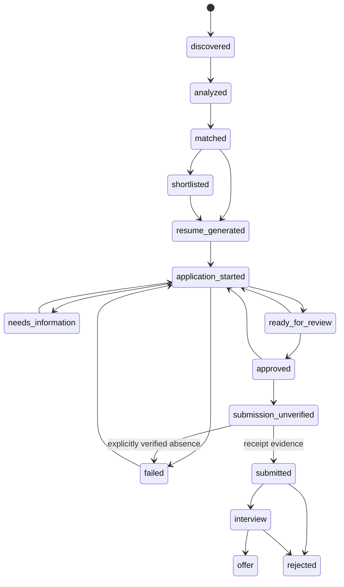

# CareerOps architecture

CareerOps is a local Python application with eight repo-scoped Codex skills. Codex supplies reasoning, authorized internet discovery, and human interaction. Deterministic Python supplies parsing, normalization, matching, selection, rendering, checkpoints, and policy enforcement. No remote model service or API key is required.

## Component boundaries

| Component | Responsibility |
|---|---|
| `models/contracts.py` and `schemas/v1/` | Strict Pydantic artifacts, candidate provenance and validation |
| `common/config.py` | Validated preferences and workspace paths |
| `resume/profile.py` | Legacy YAML normalization; preserve all source fields |
| `search/providers.py` | Public feed integrations, HTML/JSON-LD extraction, permitted fetching |
| `matching/analysis.py` | Evidence-preserving offline requirements analysis |
| `matching/scoring.py` | Configurable heuristic ranking and separate eligibility review |
| `resume/tailoring.py` | Evidence selection and constrained factual rewrites |
| `resume/documents.py` and `templates/` | Escaped LaTeX, compilation, PDF validation and previews |
| `browser/adapter.py` and `playwright_driver.mjs` | Replaceable browser protocol and isolated Node Playwright session |
| `applications/forms.py` | Semantic mapping and exact verified answers |
| `applications/service.py` | Review, stale-form detection, upload checks and one-attempt submission |
| `storage/repository.py` | SQLite migrations, transactions, immutable application events |
| `common/workflow.py` | Stage coordination, bounded search/ranking and content-addressed caches |
| `cli/main.py` | Typer CLI and structured errors |

SQLite uses Python's mature standard library, parameterized queries, WAL, foreign keys, short transactions, and `BEGIN IMMEDIATE` for mutable state. This avoids adding an ORM for a small repository. Schema version 1 is installed transactionally. Future versions must be added in order to `Repository.migrate`; never edit or remove the migration history to reset a user's store.

Feed providers accept an injected `Fetcher`/httpx client. ApplicationService accepts a `BrowserDriver` factory. Workflow accepts a Repository. Renderers receive the template directory. Test doubles exercise the same interfaces without real employers.

## Checkpoints, revisions and concurrency

Job analyses, matches, profiles and documents have input hashes and versioned contracts. A changed description/profile/preference/template invalidates its relevant cache. Resume revisions remain under `versions/HASH/`; stable job-level filenames point to the selected revision. Original resume.yaml stays unchanged. Analysis and search/ranking use bounded threads; browser preparation is sequential and uses a fresh context per application. No authenticated browser storage is persisted.

Jobs are deduplicated by canonical URLs (preserving job identity query parameters) or a verified source/company/ATS identifier. Equal company/title/location alone never merges distinct jobs. Custom links also register the source board in SQLite, disabled until configured. Excluded jobs remain in the store and in filtered_jobs.json.

## Submission state machine

Withdrawals are permitted from appropriate active/post-submission states. All transitions are validated by an explicit table. Every application has an immutable event history enforced with SQLite UPDATE/DELETE triggers.

An approval binds job identity, application URL, field labels/requiredness/options, exact answers and provenance, profile hash and PDF hash. It expires after one hour. Repreparation invalidates it. Before a browser clicks submit, a compare-and-set transaction changes approved to submission_unverified. A competing worker or a crash cannot claim the same attempt again. Only positive confirmation evidence permits submitted. Ambiguous attempts are never automatically retried.
